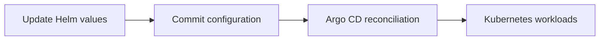

# Retail Store GitOps Repository

This repository serves as the **Single Source of Truth** for the Retail Store Microservices application. It is designed for a **GitOps** deployment workflow using **ArgoCD** on Kubernetes.

Unlike the application source code repositories, this repository contains only the Kubernetes manifests, Helm charts, and environment-specific configurations required to run the infrastructure.

## At a glance




## 📖 Architecture Overview

* **Deployment Tool:** ArgoCD
* **Package Manager:** Helm
* **Infrastructure:** Kubernetes (AWS)
* **Service Exposure:** NodePort (Dev/Test), LoadBalancer (Prod)

## 📂 Repository Structure

The repository is organized to separate the "App of Apps" pattern from the actual service definitions.

```text
.
├── applications/             # ArgoCD "Parent" manifests
│   ├── application-ui.yaml   # Defines where the UI runs and which repo to use
│   ├── application-cart.yaml
│   └── ...
├── apps/                     # Helm Charts & Configurations for each service
│   ├── ui/
│   │   ├── templates/        # K8s manifest templates
│   │   ├── values.yaml       # Default configuration (Base)
│   │   └── values-prod.yaml  # Production overrides (Replica counts, etc.)
│   ├── cart/
│   └── catalog/
└── dependencies/             # Shared infra (RabbitMQ, Redis, DBs)
```

## 🌍 Environments & Configuration

We use Helm Value Files to manage differences between environments (Dev, Staging, Production) without duplicating code.

| Environment | Config File | Description |
|-------------|-------------|-------------|
| Base / Dev | `values.yaml` | Default settings. Uses NodePort for easy access and minimal resources (1 replica). |
| Staging | `values-staging.yaml` | (Optional) Mirrors prod settings but with internal access only. |
| Production | `values-prod.yaml` | High availability settings. Uses LoadBalancer, higher resource limits, and multiple replicas. |

To deploy to a specific environment:

ArgoCD Application manifests in `applications/` point to the specific `values.yaml` file required for that environment.

## 🚀 Deployment Flow (The GitOps Cycle)

1. **Code Change**: A developer updates the application source code and pushes a new Docker image.

2. **Config Update**: We update the `image.tag` in the relevant `values.yaml` in this repository.

3. **Commit & Push**:
   ```bash
   git commit -am "Bump UI version to v1.2.0"
   git push origin main
   ```

4. **Auto-Sync**: ArgoCD detects the change in this Git repository.

5. **Reconciliation**: ArgoCD applies the new manifests to the Kubernetes cluster.

6. **Self-Healing**: If anyone manually changes the cluster (e.g., `kubectl edit`), ArgoCD detects the drift and reverts it to match this repository.

## 🛠 Accessing the Application

Current service exposure configuration (Default/Dev):

- **ArgoCD UI**: `https://<NODE-IP>:30692`
- **Retail Store UI**: `http://<NODE-IP>:30976`

(Replace `<NODE-IP>` with the Public IP of any node in the cluster. Ensure Security Groups allow traffic on these ports.)

## 📦 Prerequisites for Deployment

- A Kubernetes Cluster (v1.20+).
- ArgoCD installed in the `argocd` namespace.
- This repository connected to ArgoCD.

## 🔧 Troubleshooting

### "My manual kubectl changes keep disappearing!"

This is intentional. ArgoCD creates a self-healing environment.

- ❌ **Don't**: Run `kubectl edit svc ...`
- ✅ **Do**: Edit `apps/<service>/values.yaml`, commit, and push.
